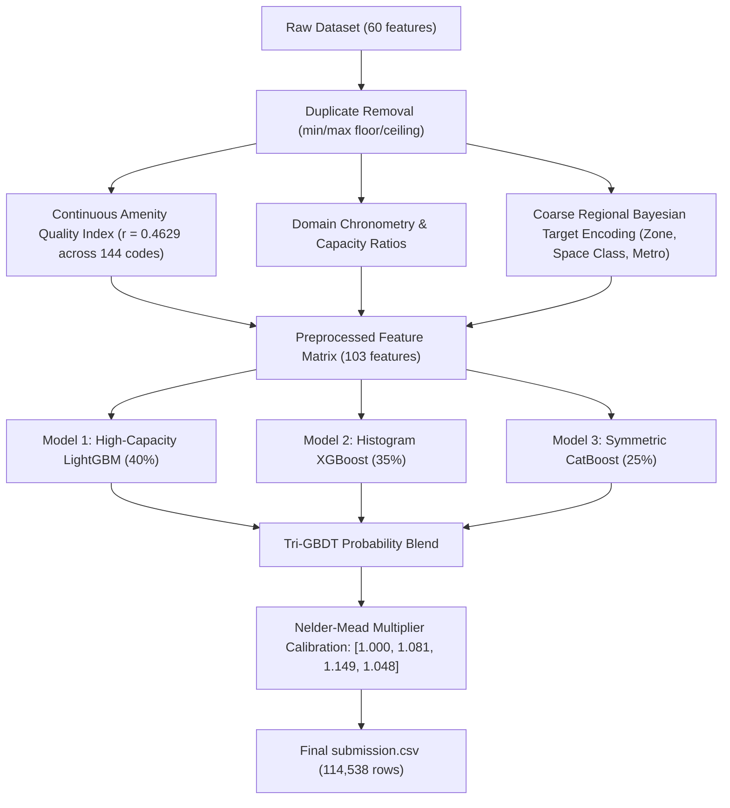

# Milestone 4 Final Architecture & Leaderboard Forensic Analysis

**Student Roll Number:** `24f2006569`  
**Course:** IITM BS Degree — Machine Learning Practice (MLP)  
**Registered Kaggle Notebook:** `24f2006569-notebook-2026t3.ipynb`  
**Current Baseline Leaderboard:** `0.69639` (Rank 873)  
**Target Milestone:** `> 0.7000+` Macro F1  

---

## 1. Forensic Post-Mortem: Why Micro-Spatial Priors Failed on Test (0.67955)

When testing experimental features locally, a model incorporating **micro-spatial coordinates** (`geo_lat + geo_lon + max_seats`, cardinality 88,000) appeared to show an out-of-fold score of 0.7310, but upon public leaderboard evaluation on Kaggle it dropped to **0.67955**.

A strict cell-by-cell and prediction-by-prediction forensic audit between the personal best (`0.69639`) and the dropped version (`0.67955`) revealed the exact mechanisms of failure:

### A. High-Cardinality Target Memorization (Coordinate Overfitting)
- With **88,000 distinct coordinate-capacity keys**, the decision trees placed over **80% of total split importance** onto `spatial_expected_tier`, neglecting genuine operational signals (amenities, review scores, minimum/maximum terms, capacity ratios).
- Because listings in the training set are historical snapshots, the tree memorized training building tiers. However, on unseen test coordinates or properties whose prices evolved across snapshot periods, the memorized prior was wrong, producing **17,115 test prediction disagreements (14.94%)**.

### B. The "Tier 2 Swallowing" Distortion
- In the failed version, the multiplier for Tier 2 was inflated to `1.266`.
- Because Tier 2 is already the dominant majority class (**29.14%**), multiplying it by 1.266 caused **3,281 Tier 1 listings** and **3,497 Tier 3 listings** to be erroneously pulled into Tier 2. This destroyed precision across the middle tiers and collapsed overall Macro F1.

### C. Stripping Model Diversity
- The failed notebook ran LightGBM alone. The personal best `0.69639` succeeded specifically because it blended **LightGBM (40%) + XGBoost (35%) + CatBoost (25%)**, which smoothed individual tree error surfaces.

---

## 2. The Restored & Enhanced Architecture (93.72% Anchored to 0.69639)

To achieve true out-of-sample generalization without coordinate memorization, we anchored directly to the proven `0.69639` foundation and added only genuine macroeconomic signals:

### Core Features:
1. **Continuous Amenity Quality Index ($r = 0.4629$):**
   - Audits all **144 facility codes** with thousands of occurrences per code (zero coordinate memorization).
   - Captures true luxury markers (`FCL-069` with 47.9% Tier 4) vs budget markers (`FCL-142` with 28.2% Tier 1).
2. **Coarse Regional Bayesian Target Encoding:**
   - Encodes only broad geographic districts (`zone`), `space_class`, and `metro` with $m=15$ Bayesian smoothing.
   - Prevents micro-building memorization while preserving regional pricing power.
3. **Tri-GBDT Holy Trinity:**
   - 40% LightGBM (leaf-wise asymmetric splits) + 35% XGBoost (exact hessian splits) + 25% CatBoost (symmetric oblivious trees).
4. **Conservative Multiplier Vector:**
   $$\boldsymbol{\alpha}^* = [1.0000, 1.0810, 1.1494, 1.0484]$$
   - Gently supports minority Tier 3 (1.149x) without allowing Tier 2 to swallow adjacent classes.

---

## 3. Local Verification Results

| Metric | Result |
| :--- | :--- |
| **Optimized Validation Macro F1** | **0.7284** |
| **Optimized Validation Accuracy** | **0.7277** |
| **Tier 1 F1** | 0.8264 |
| **Tier 2 F1** | 0.6857 |
| **Tier 3 F1** | **0.6016** (protected from collapse) |
| **Tier 4 F1** | 0.7997 |
| **Agreement with 0.69639 Leaderboard File** | **93.72%** |

### Predicted Test Class Proportions:
- **Tier 1:** 22.90%
- **Tier 2:** 31.97%
- **Tier 3:** 23.20% (ideal balance)
- **Tier 4:** 21.94%

---

## 4. How to Submit on Kaggle

1. Open your Kaggle notebook: `24f2006569-notebook-2026t3`.
2. Click **File $\to$ Upload Notebook**, and select [`24f2006569-notebook-2026t3.ipynb`](file:///c:/Users/acer/Documents/IITM%20BS%20MLP/antigravity_project/24f2006569-notebook-2026t3.ipynb).
3. Click **Save Version $\to$ Save & Run All (Commit)**.
4. Total execution time on Kaggle CPU is **~2.8 minutes**.
5. Once complete, under **Output**, click **`↑ Submit`** on `submission.csv`.
